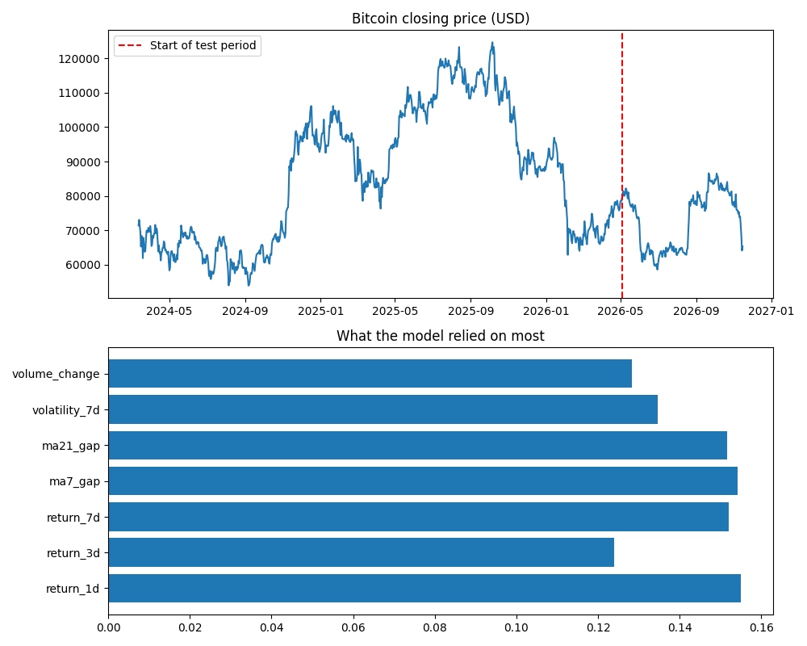

# Bitcoin Price Direction Predictor

A beginner machine learning project in Python that tries to predict whether Bitcoin's price will go up or down the next day.



## What it does

1. Downloads about 1,000 days of daily Bitcoin prices from the public Binance API
2. Builds features: 1, 3 and 7-day returns, 7 and 21-day moving average gaps, 7-day volatility and volume change
3. Trains a Random Forest classifier (scikit-learn) on the older 80% of the data
4. Tests it on the newest 20% (196 days it has never seen)
5. Compares the result with a simple baseline and saves a chart

## Results

| | Accuracy |
|---|---|
| Random Forest model | 52.6% |
| Baseline (always guess the most common move) | 48.0% |

The model scored only slightly above the baseline, a gap too small to call real skill. Short-term price moves are very hard to predict from simple price features, so this is the expected outcome. The value of the project is the workflow: data collection, feature building, a fair time-based test and an honest comparison.

## Tech Stack

Python, pandas, scikit-learn, matplotlib, requests

## How to Run

```
pip install pandas scikit-learn requests matplotlib
python predict.py
```

## Notes

This is a learning project, not financial advice or a trading tool.
